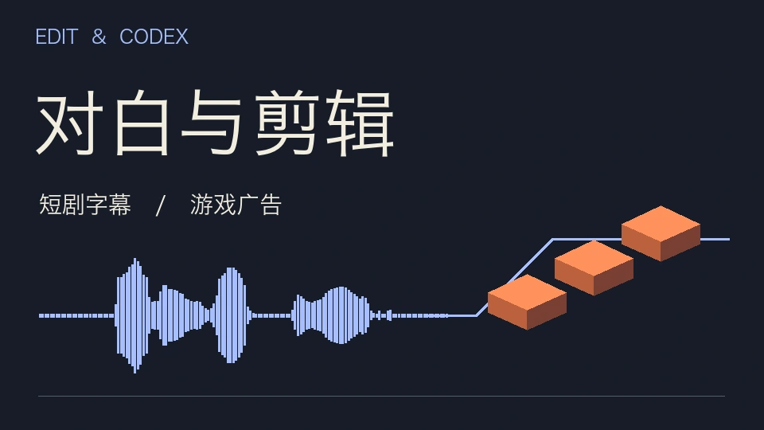

# Dialogue & edit

[中文](README.md) · [日本語](README.ja.md) · English

Ten minutes of Japanese drama can mean finding the start and end of more than a hundred subtitle cues. I built a workflow in Codex for the repeated work of locating speech, drafting text and laying it on a timeline. These two case studies follow the material through actual edits and measurements.

### Drama | From location recordings to an editable subtitle track

For episodes 3–10 of *Sakura Ran* (桜乱), seven source files covered **10 min 46 s and yielded 150 draft cues**. I ran transcription, segmentation and timing locally. When a voice disappeared under location noise, I lined up two tracks at the same cut. The editor could jump to that line and change its wording or timing.

I also repeated the draft stage on a separate **43.21 s** ACOPY source. On an Apple M4, three fresh runs each wrote the same ten timed cues, in a median of **10.19 s**. [Watch the 36-second English film](https://github.com/NENGXT/edit-codex-workflows/raw/refs/heads/main/examples/films/dialogue-en.mp4) · [Compare the recordings](docs/dialogue.en.md) · [Production counts](examples/speech/review/production.csv) · [Timing results](examples/speech/review/benchmark.json)

### Advertising | Turning “that reaction comes too early” into a cut

In a *Whiteout Survival* ad the machine is still blocked at 42.83 s. Its first item comes out at 47.70 s, so that is where I put the actor’s “I did it!” I then measured the export: dialogue was about **88 ms** late, the end card about **44 ms** late. I corrected them separately and retested **40 onsets**.

A separate ad needed a Japanese voice pickup. With permission to clone the speaker’s voice, I auditioned different deliveries of the same line. For one revision I asked to flatten just the opening of an 8.48 s take. Its final **6.32 s matched the previous take sample for sample**. [Watch the 36-second English film](https://github.com/NENGXT/edit-codex-workflows/raw/refs/heads/main/examples/films/edit-en.mp4) · [See the edit and voice decisions](docs/edit.en.md)

### Follow the work

The [drama notes](docs/dialogue.en.md) and [ad notes](docs/edit.en.md) follow each request through to the next revision. [Inside the edit session](docs/conversations.en.md) reconstructs my instructions, the output and what I decided to change in the next round.

[Subtitle models and benchmark](models/README.md) · [Production tools and film rendering](docs/production.md) · [Example edit instructions](prompts/README.md) · [Practice recording credits](examples/speech/CREDITS.md)
