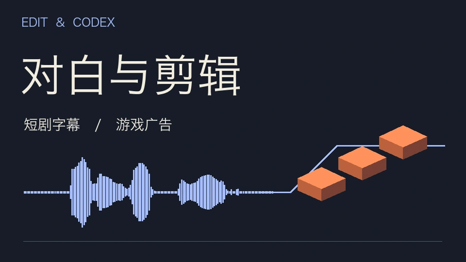
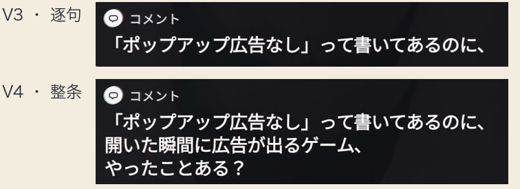

# セリフと編集

[中文](README.md) · 日本語 · [English](README.en.md)

日本語の短編ドラマを編集すると、素材が十数分でも字幕の入りと終わりを百か所以上拾うことがある。私は繰り返していた頭出し、文字起こし、尺合わせをCodexからまとめて処理するようにした。以下は実際の素材と改稿記録からたどれる二つの事例。

### ドラマ｜現場の音から編集用の字幕トラックへ

『桜乱』第3〜10話。素材7本は計**10分46秒、初稿の字幕は150枚**。各話をローカルで文字起こしし、分割とタイムコード付けまで進めた。聞き取りづらい箇所は現場音と抽出した声を同じカットに揃える。編集者は該当箇所へ直接戻って、表記や入りを調整できる。

別に、未処理のACOPY 43.21秒をApple M4で3回処理した。いずれも同じ時間付き字幕10枚を出力し、SRTを書き終えるまでの中央値は**10.19秒**だった。[36秒の日本語版を再生](https://github.com/NENGXT/edit-codex-workflows/raw/refs/heads/main/examples/films/dialogue-ja.mp4) · [音を聴き比べる](docs/dialogue.ja.md) · [話数別の内訳](examples/speech/review/production.csv) · [計測結果](examples/speech/review/benchmark.json)

### 広告｜「反応が早い」を、確かめられるカット位置へ

『Whiteout Survival』では42.83秒の時点で品物がまだ詰まっている。最初の一つが出る47.70秒に「できた！」を置いた。書き出しの音を測ると、セリフは約**88ms**、エンドカードは約**44ms**遅れていた。トラック別に補正し、**40か所**の音の入りを再測定した。

別の広告では、日本語の追加収録が必要になった。許諾を得た声でクローン音声を試作し、同じセリフで読み方を比較。出だしだけを抑えた8.48秒の試作では、2.16秒以降の**6.32秒が元の音声とサンプル単位で一致**した。[36秒の日本語版を再生](https://github.com/NENGXT/edit-codex-workflows/raw/refs/heads/main/examples/films/edit-ja.mp4) · [編集と追加音声の記録](docs/edit.ja.md)

### 制作の過程と再現方法

[ドラマの制作ノート](docs/dialogue.ja.md)と[広告の制作ノート](docs/edit.ja.md)では、指示、出力、次の判断を日本語で追える。[編集セッションの記録](docs/conversations.ja.md)では、指示のあと、どの音や画を見て次の修正を決めたかまで追える。

[字幕モデルと計測手順](models/README.md) · [検証ツール・三言語の動画生成](docs/production.md) · [制作指示の例](prompts/README.md) · [練習音源のクレジット](examples/speech/CREDITS.md)
