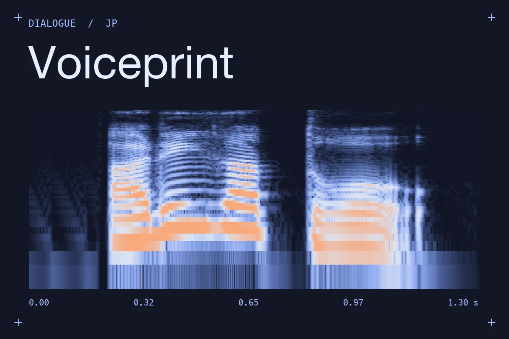
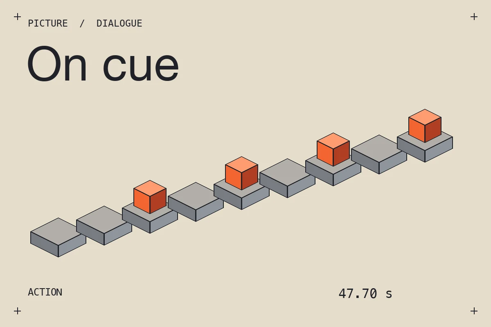

# EDIT & CODEX · 制作幕后

我用 Codex 做短剧字幕和游戏广告后期。聊天里定下来的，通常是很小的事：一句话到底说了什么，一个反应该落在哪一帧。这份仓库把用得上的做法和能复跑的样例留了下来。

<a href="docs/dialogue.md"></a> <a href="docs/edit.md"></a>

| 想看什么 | 从这里开始 |
| --- | --- |
| 听一声日语，再看字幕怎么对时 | [公开样音](examples/speech/thanks.wav) · [本机实际生成的字幕](examples/speech/thanks.srt) · [逐词结果](examples/speech/thanks.json) |
| 看一条广告里反应怎么跟上动作 | [三个剪点和交付检查](docs/edit.md) |
| 在自己的 Mac 上复现 | [本地 ASR 与对齐模型](models/README.md) |
| 把同类任务交给 Codex | [制作指令](prompts/README.md) · [交接表](templates/handoff.md) |
| 找配音试听、字幕压制和调色资料的做法 | [制作工具索引](docs/production.md) |

## 日语短剧

演员临场会改词。我先让 Codex 准备带时间码的识别初稿，再回到原声复听有争议的几秒。最容易漏掉的是一句轻声的接话，尤其在片尾。整理完字幕，还要逆着检查：哪些有声音的地方，稿子里却空着？[对白工作流](docs/dialogue.md)

## 游戏广告

我先看发生了什么，再定达人应该什么时候开口。升级、出料、「できた！」，这三个动作有先后。等剪辑节奏定了，再核对字幕、小窗和实际导出文件。仓库里的时间点来自一次竖版广告交接，分镜图为示意。[剪辑工作流](docs/edit.md)

## 动手试

安装 Python、FFmpeg（含 ffprobe），然后在本仓库目录运行：

```sh
python3 -m venv .venv
. .venv/bin/activate
python -m pip install -r requirements.txt
python tools/test_checks.py
python tools/draw_plates.py out/plates
```

第一条 Python 命令会生成临时音视频，检查声音偏移、重复声音和画面提前结束的情况。第二条会用公开样音和剪点记录生成六张演示插图。Apple Silicon 的日语识别复现另见模型页。

公开样音来自 Lingua Libre，作者与许可见[署名说明](examples/speech/CREDITS.md)。客户原片、台本、私人对话和真人参考音色保存在制作工作区。仓库里的对话指令均为重写示例。文章与仓库的整理方式参考了[余弦的制作复盘](https://blog.cosine.ren/post/ai-assisted-tutorial-workflow)和[配套仓库](https://github.com/yusixian/ai-tutorial-workflow)。
