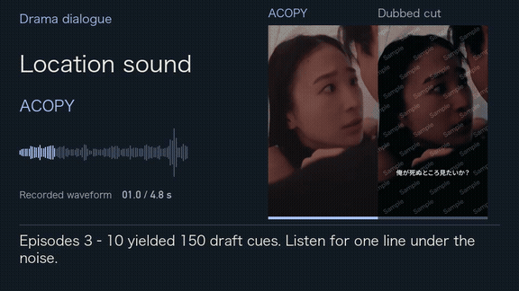

# A subtitle track for *桜乱*: 150 draft cues across eight episodes

[中文](dialogue.md) · [日本語](dialogue.ja.md) · English · [Home](../README.en.md)

[Watch the 36-second English film](https://github.com/NENGXT/edit-codex-workflows/raw/refs/heads/main/examples/films/dialogue-en.mp4) · [Chinese](https://github.com/NENGXT/edit-codex-workflows/raw/refs/heads/main/examples/films/dialogue.mp4) · [Japanese](https://github.com/NENGXT/edit-codex-workflows/raw/refs/heads/main/examples/films/dialogue-ja.mp4)

The recurring cost was winding back to each line, finding both ends and typing it onto a blank timeline. I built a timed first pass so the editor could work in picture and go straight to the few seconds that needed attention.

**Listen to the same 4.8 seconds three ways.** The unprocessed ACOPY is on the left and a later, watermarked review cut is on the right. You hear the location sound, the voice isolated from that sound, then the studio dub. The clear performance in the third pass comes from the later voice session. [Play just the isolated voice](../examples/speech/review/acopy-voice.m4a)

## What the production records show

Episodes 3–10 used seven files lasting 10 min 46 s in total. Episodes 3 and 4 shared one file. Each number below is from the first candidate handoff for that file, including work on difficult passages. Later revisions could add or merge cues.

| Episodes | 3+4 | 5 | 6 | 7 | 8 | 9 | 10 | Total |
| --- | ---: | ---: | ---: | ---: | ---: | ---: | ---: | ---: |
| First candidate cues | 29 | 10 | 12 | 16 | 9 | 19 | 55 | **150** |

[Source lengths and cue counts](../examples/speech/review/production.csv)

## Three decisions in the edit

1. **Build the first timeline in batches.** I specify the episodes in chat. Local Whisper writes text and time spans for each file. FFmpeg burns those cues into review copies so early entrances and captions that spill into the next line are visible in the cut.
2. **Go back to the exact take.** In the original, this passage runs from 27.0–31.8 s. In the revised cut it is at 32.8–37.6 s. For this demonstration I isolated the location voice with BS-RoFormer and ran Qwen3-ASR on both tracks. The original produced “拷問あるか”; the isolated voice gave “ごめんあるから.” [Original-track SRT](../examples/speech/review/acopy-asr.srt) · [Isolated-track SRT](../examples/speech/review/acopy-voice-asr.srt)
3. **Make the line work in the scene.** A draft from an earlier production pass said “ごめん、やるから.” The character is asking for help and offering a reward. I settled on “手を貸せ。ご褒美やるから。” (“Give me a hand. I’ll reward you.”), joined two cues and checked the neighbouring timings in the review cut.

## Timing the first pass

I ran one complete **43.21 s** ACOPY from the July 19 cut through local Whisper large-v3 on an Apple M4. Three fresh processes wrote identical ten-cue SRT files in 10.192, 10.629 and 9.873 seconds. Median **10.19 s**, or **4.24× real time** for this transcription pass. Timing includes loading the local model, decoding, inference and writing the SRT. There was no timed manual control. This test source is a different edit from the 48 s episode 5 in the production table. [All runs and cue intervals](../examples/speech/review/benchmark.json) · [Model and command notes, Chinese](../models/README.md)

One quality check mattered before the draft reached the editor. In the combined file for episodes 3 and 4, the recognizer filled about 7.8 opening seconds with repeated “ん” and added “Thank you for watching” over the final scene. I checked voice activity and picture, dropped those entries and handed over 29 cues.

[Follow the directions and revisions](conversations.en.md#drama-subtitles)
