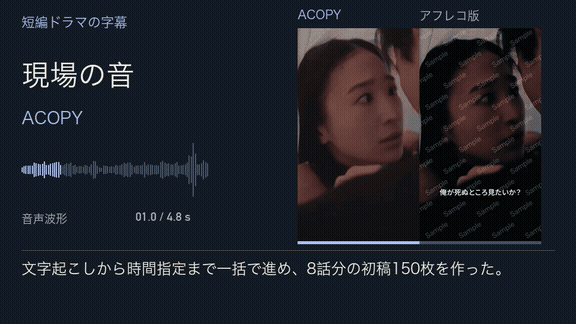

# 『桜乱』｜白紙のタイムラインから字幕初稿150枚へ

[中文](dialogue.md) · 日本語 · [English](dialogue.en.md) · [トップ](../README.ja.md)

[36秒の日本語版を再生](https://github.com/NENGXT/edit-codex-workflows/raw/refs/heads/main/examples/films/dialogue-ja.mp4) · [中文](https://github.com/NENGXT/edit-codex-workflows/raw/refs/heads/main/examples/films/dialogue.mp4) · [English](https://github.com/NENGXT/edit-codex-workflows/raw/refs/heads/main/examples/films/dialogue-en.mp4)

減らしたかったのは、巻き戻して一言ずつ頭を探し、終了位置を打ち込む作業だ。字幕の下地を先に作っておけば、音が潰れた言葉や芝居と食い違う字幕だけを、その場面で聞き直せる。

**まず4.8秒の聴き比べ。** 左は未処理のACOPY、右は後日アフレコした透かし入りの試写版。最初の3章では、現場音、そこから抽出した声、後日のアフレコを順に聞ける。左右の動きは揃えてある。[抽出した声だけを再生](../examples/speech/review/acopy-voice.m4a)

## 制作で扱った量

第3〜10話は素材7本、合計10分46秒。第3・4話は1本にまとまっている。最初の候補字幕の枚数を、各ファイルの制作記録から集計した。

| 話数 | 3+4 | 5 | 6 | 7 | 8 | 9 | 10 | 合計 |
| --- | ---: | ---: | ---: | ---: | ---: | ---: | ---: | ---: |
| 初稿の枚数 | 29 | 10 | 12 | 16 | 9 | 19 | 55 | **150** |

初稿には文字起こし後の難所の聞き直しと整理も含まれる。後に字幕を足したり1枚にまとめたりすると、枚数は変わる。[素材尺と初稿の内訳](../examples/speech/review/production.csv)

## 私が組んだ手順

1. **バッチで字幕の下地を作る。** 対話で対象話を指定し、Whisperで各ファイルのセリフと開始・終了時刻を出す。FFmpegで試写用の映像に焼き込み、カットに対して早すぎる入りや、次のセリフまで残る字幕を確かめる。
2. **同じカットで音を聴き比べる。** 原素材の27.0〜31.8秒が、別編集では32.8〜37.6秒に当たる。今回BS-RoFormerで声を分離し、同じQwen3-ASRで比較したところ、元の音からは「拷問あるか」、分離した声からは「ごめんあるから」と出た。[元の音声のSRT](../examples/speech/review/acopy-asr.srt) · [分離後のSRT](../examples/speech/review/acopy-voice-asr.srt)
3. **芝居を基準に字幕を返す。** 制作時の別版の初稿には「ごめん、やるから」とあった。相手に手助けを頼み、見返りを約束する場面だ。私は「手を貸せ。ご褒美やるから。」と定め、2枚を1枚につなぎ、前後のタイミングも確認した。

## 文字起こしの実測

7月19日版のACOPY一本（43.21秒）をApple M4のローカルWhisper large-v3で3回処理した。所要時間は10.192秒、10.629秒、9.873秒。毎回同じ10枚の時間付き字幕が出力され、中央値は**10.19秒、素材尺の4.24倍速**だった。モデルの読み込み、デコード、文字起こし、SRTの書き込みを含む。人による確認時間は別。制作集計に載せた48秒の第5話とは編集版が異なる。[計測結果と10区間](../examples/speech/review/benchmark.json) · [技術手順（中国語）](../models/README.md)

第3・4話の素材では、冒頭の約7.8秒に「ん」が並び、劇中のまま終わるラストに「ご視聴ありがとうございました」が入っていた。発声の有無と映像を照合し、どちらも外して初稿29枚を渡した。

[指示と判断を順に読む](conversations.ja.md#短編ドラマの字幕)
