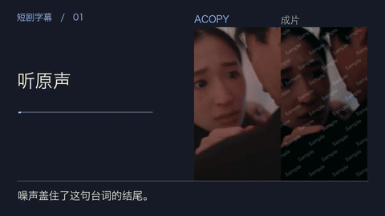

# 《桜乱》｜从空白时间线到 150 条候选字幕

中文 · [日本語](dialogue.ja.md) · [English](dialogue.en.md) · [返回首页](../README.md)

[播放 36 秒中文解说](https://github.com/NENGXT/edit-codex-workflows/raw/refs/heads/main/examples/films/dialogue.mp4) · [日本語版](https://github.com/NENGXT/edit-codex-workflows/raw/refs/heads/main/examples/films/dialogue-ja.mp4) · [English film](https://github.com/NENGXT/edit-codex-workflows/raw/refs/heads/main/examples/films/dialogue-en.mp4)

我想省下的是找句头、拖播放头、敲时间码的时间。识别结果一旦落到时间线上，我就可以谈具体镜头。遇到噪声、低语或模型写得通顺却跟表演对不上的词，还能随时调出那几秒的原声。

**先听这 4.8 秒。** 画面左边是未处理的 ACOPY，右边是后来配过音的带水印审片。解说的前三段依次播放现场原声、从原声分离出的人声、后期配音。动作已经对齐。第三遍听到的清晰表演来自后期配音。[单听分离人声](../examples/speech/review/acopy-voice.m4a)

## 一次制作到底处理多少

第 3–10 集涉及 7 个源文件，第 3、4 集已合并。下表取自各份**第一版候选稿**的交接记录，片长四舍五入到秒。候选稿包含识别、难句处理和整理。后来补词、并句时，条数也随之变化。

| 源片 | 3+4 集 | 5 集 | 6 集 | 7 集 | 8 集 | 9 集 | 10 集 | 合计 |
| --- | ---: | ---: | ---: | ---: | ---: | ---: | ---: | ---: |
| 片长 | 2:14 | 0:48 | 0:49 | 0:51 | 1:30 | 1:36 | 2:58 | 10:46 |
| 首版候选字幕 | 29 | 10 | 12 | 16 | 9 | 19 | 55 | **150** |

在第 3、4 集合并原片里，模型在开头约 7.8 秒连续写了「ん」，片尾又补了一句「ご視聴ありがとうございました」。现场声的人声检测和片尾画面都撑不起这两处。我把它们从候选稿里剔除，留下 29 条。

[逐文件数据](../examples/speech/review/production.csv)

## 我怎样带着对话改片

1. **把整批片源铺到时间线上。** 我在对话里指定集数，让本机按文件跑 Whisper、写字幕、保留每句的起止时间。再让 FFmpeg 把 SRT 压进审片副本，看片就能发现字幕抢早、拖长或压到下一句。
2. **把反复听整集，变成复听一个镜头。** 我从原片定位到 27.0–31.8 秒；另一版剪辑里，同一镜头是 32.8–37.6 秒。本次复演用 BS-RoFormer 分离现场声，让同一个 Qwen3-ASR 分别听两轨。原声给出「拷問あるか」，人声轨给出「ごめんあるから」。两种写法都解释不了角色为什么向对方要帮忙。[原声识别](../examples/speech/review/acopy-asr.srt) · [人声轨识别](../examples/speech/review/acopy-voice-asr.srt)
3. **按角色的意思定词，把修订带回片子。** 制作时另一版初稿写成「ごめん、やるから」。我指出角色是在许诺奖励，定下「手を貸せ。ご褒美やるから。」随后把拆开的两条并成一句，检查相邻字幕，再看画面。分离轨帮我找到了要听的地方，人物关系决定了最后落哪几个字。[查看制作对话](conversations.md#短剧字幕)

## 从按下运行到拿到文件

为单独量出机器承担的工作，我重新取了 7 月 19 日版一份完整 ACOPY，长 **43.21 秒**。在 Apple M4 上用本地 Whisper large-v3，三次分别用 **10.192、10.629、9.873 秒**写成 SRT，文件内容完全相同。每份有 **10 条带起止时间的候选**。计时包括加载本地模型、解码、识别和写文件。此次单段起稿速度相当于片长的 **4.24 倍实时速度**；没有同期人工工时记录。

9 月的制作统计用的是当时的剪辑版本。复测的 43.21 秒片源与上表 48 秒的第 5 集是不同剪辑。[三次计时与十段实际区间](../examples/speech/review/benchmark.json) · [模型、字幕和复现命令](../models/README.md)
